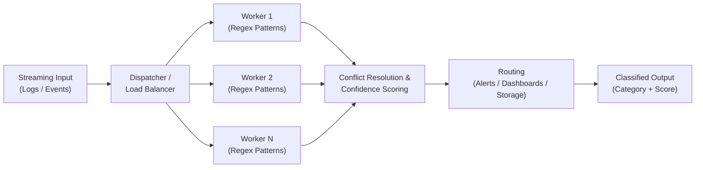

# Real-Time Parallel Log / Event Triage Engine

*Compiler Design Lab — Review 1 submission (Submission 6). Converted from `Compiler_Design_Lab_Submission_6.pdf`. Extends the base paper in `base_paper.md`.*

**Team 1**
- 24BCI0099 — Adithya Santhosh P
- 24BCT0055 — Anvesha Tripathi

## Abstract

This project extends a multi-core, parallel regex-based text classification system from classifying short, standalone text strings to classifying continuous, high-volume streaming data such as server logs and system events. By distributing regex pattern matching across multiple CPU cores and applying confidence-based conflict resolution, the system aims to classify incoming log lines in real time into categories such as errors, security threats, performance warnings, authentication failures, and potential PII exposure, enabling faster and more scalable automated monitoring.

## Introduction

Modern systems generate large volumes of logs and events every second, and manually reviewing this data is impractical. Traditional sequential classification approaches struggle to keep up with real-time demands. The original project demonstrated that parallel regex pattern matching across multiple CPU cores can classify short text snippets quickly and accurately, achieving a measurable speedup over sequential processing.

This extension applies the same core architecture — parallel pattern matching, confidence scoring, and conflict resolution — to a streaming context. Instead of classifying one string at a time, the system continuously ingests log or event data, distributes it across worker processes for pattern matching, resolves conflicting classifications, and routes each item to the appropriate downstream handler such as an alert, dashboard, or storage system.

Typical real-world applications include:

- **Security monitoring (SOC/SIEM)** — flagging suspicious login attempts or attack patterns.
- **Customer support triage** — auto-tagging incoming tickets by category and urgency.
- **IoT data pipelines** — classifying sensor readings as valid or malformed in real time.
- **Compliance monitoring** — detecting PII in outgoing data before it leaves a network.
- **Chat/voice assistants** — scaling intent classification to concurrent multi-user traffic.

## Architecture Diagram

Flow: Streaming Input → Dispatcher/Load Balancer → Workers 1..N (each running regex patterns) → Conflict Resolution & Confidence Scoring → Routing (Alerts / Dashboards / Storage) → Classified Output (Category + Score).
